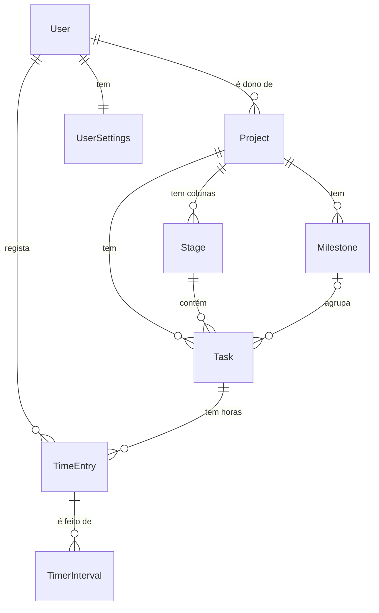

# Modelos de dados: taskManager (v1)

Desenho dos modelos antes de os escrever em Django (tarefa 3 do [plano](plano.md)).
Os nomes das classes e dos campos estão em inglês, como vão ficar no código. As explicações estão em português.

Não inclui ainda Documentos, backlog e tickets (Should / fases futuras). A secção [Evoluções previstas](#evoluções-previstas) mostra que o modelo não os impede.

## Diagrama



---

## User

Modelo de utilizador **próprio desde o início**, mesmo que vazio:

```python
class User(AbstractUser):
    pass
```

Com `AUTH_USER_MODEL = "accounts.User"` nas settings.

**Porquê:** a documentação do Django recomenda-o em todos os projetos novos. Trocar o modelo de utilizador depois de haver migrações é muito difícil, e as fases futuras (utilizadores, SSO) vão precisar de campos novos.

---

## Projeto (`Project`)

| Campo         | Tipo             | Obrigatório?       | Omissão        | Notas                                                                           |
| ------------- | ---------------- | ------------------ | -------------- | ------------------------------------------------------------------------------- |
| `owner`       | FK → User        | sim                |                | `CASCADE`: os projetos são dados do utilizador                                  |
| `name`        | `CharField(200)` | sim                |                |                                                                                 |
| `description` | `TextField`      | não (`blank=True`) | `""`           | Markdown. Vazio em vez de `NULL`, que é a convenção do Django para texto        |
| `archived_at` | `DateTimeField`  | não (`null=True`)  | `NULL`         | `NULL` = ativo. Guarda também _quando_ foi arquivado, o que um booleano não faz |
| `created_at`  | `DateTimeField`  | auto               | `auto_now_add` |                                                                                 |
| `updated_at`  | `DateTimeField`  | auto               | `auto_now`     |                                                                                 |

**Arquivar não é apagar.** Um projeto com horas registadas não se pode apagar (ver `TimeEntry.task`), só arquivar.

---

## Etapa (`Stage`): coluna do kanban

| Campo      | Tipo                   | Obrigatório? | Omissão | Notas                                                                                                                                                               |
| ---------- | ---------------------- | ------------ | ------- | ------------------------------------------------------------------------------------------------------------------------------------------------------------------- |
| `project`  | FK → Project           | sim          |         | `CASCADE`                                                                                                                                                           |
| `name`     | `CharField(100)`       | sim          |         |                                                                                                                                                                     |
| `sequence` | `PositiveIntegerField` | sim          | `0`     | Ordem das colunas (da esquerda para a direita)                                                                                                                      |
| `is_done`  | `BooleanField`         | sim          | `False` | Marca a coluna "Feito". Uma tarefa está terminada quando está numa etapa com `is_done` (regra 18 do timer). Também evita avisos de data limite em tarefas já feitas |

- **Etapas por projeto**, e não globais: cada projeto pode ter colunas diferentes.
- Ao criar um projeto, criam-se etapas por omissão: "Por fazer", "Em curso" e "Feito" (`is_done=True`).
- `Meta.ordering = ["sequence", "id"]`.

---

## Milestone (`Milestone`)

| Campo        | Tipo             | Obrigatório? | Omissão        | Notas                                                   |
| ------------ | ---------------- | ------------ | -------------- | ------------------------------------------------------- |
| `project`    | FK → Project     | sim          |                | `CASCADE`                                               |
| `name`       | `CharField(200)` | sim          |                | Ex: "M1: setup"                                         |
| `deadline`   | `DateField`      | não          | `NULL`         |                                                         |
| `reached_at` | `DateTimeField`  | não          | `NULL`         | `NULL` = por atingir. Mesmo raciocínio do `archived_at` |
| `created_at` | `DateTimeField`  | auto         | `auto_now_add` |                                                         |

- `Meta.ordering = ["deadline", "id"]`: ficam ordenados por prazo. Confirmar no Postgres onde ficam os que não têm prazo (por omissão, os `NULL` vão para o fim numa ordem ascendente).
- O progresso (ex: 3 de 5 tarefas feitas) calcula-se a partir das tarefas. Não é preciso guardá-lo.

---

## Tarefa (`Task`)

| Campo                  | Tipo                   | Obrigatório?       | Omissão        | Notas                                                                                                                            |
| ---------------------- | ---------------------- | ------------------ | -------------- | -------------------------------------------------------------------------------------------------------------------------------- |
| `project`              | FK → Project           | sim                |                | `CASCADE`                                                                                                                        |
| `stage`                | FK → Stage             | sim                |                | `RESTRICT`: não se apaga uma etapa com tarefas (ver nota)                                                                        |
| `milestone`            | FK → Milestone         | não                | `NULL`         | `SET_NULL`: apagar o milestone não apaga as tarefas                                                                              |
| `title`                | `CharField(255)`       | sim                |                |                                                                                                                                  |
| `description`          | `TextField`            | não (`blank=True`) | `""`           | Markdown, com checkboxes, listas e cabeçalhos                                                                                    |
| `sequence`             | `PositiveIntegerField` | sim                | `0`            | Ordem dentro da coluna, para o drag and drop                                                                                     |
| `start_date`           | `DateField`            | não                | `NULL`         | Para o Gantt (Could)                                                                                                             |
| `due_date`             | `DateField`            | não                | `NULL`         | Data limite                                                                                                                      |
| `deadline_notified_at` | `DateTimeField`        | não                | `NULL`         | Quando foi enviado o aviso de data limite (ADR 0003). É limpo quando `due_date` muda                                             |
| `estimated_minutes`    | `PositiveIntegerField` | não                | `NULL`         | Estimativa, como as "horas alocadas" do Odoo. Permite comparar o estimado com o real. |
| `created_at`           | `DateTimeField`        | auto               | `auto_now_add` |                                                                                                                                  |
| `updated_at`           | `DateTimeField`        | auto               | `auto_now`     |                                                                                                                                  |

- `Meta.ordering = ["stage__sequence", "sequence", "id"]`.
- **Data, não data e hora**, nas datas da tarefa: é a granularidade do Odoo e chega para os avisos.

**Porquê `RESTRICT` e não `PROTECT` no `stage`:** ao apagar um _projeto_, o Django apaga em cascata as etapas e as tarefas. Com `PROTECT`, essa cascata falha, porque as tarefas "protegem" as etapas. O `RESTRICT` deixa apagar quando a tarefa também está a ser apagada na mesma cascata, mas continua a impedir que se apague uma etapa sozinha enquanto tiver tarefas.

**Ordem no drag and drop (`sequence`):** ao mover uma tarefa, renumeram-se as tarefas da coluna de destino (0, 1, 2…). Com poucas tarefas por coluna e um só utilizador, é a opção mais simples (KISS). Há alternativas (deixar espaços entre números, ou ordem fracionária), mas só fazem falta com muitas tarefas ou muitos utilizadores em simultâneo.

---

## Tempo: `TimeEntry` e `TimerInterval`

Regras em [timer.md](timer.md).

**A sessão é uma entidade própria:** o `TimeEntry`, ou seja, uma linha do registo de horas, como um timesheet do Odoo. Dentro dela, cada período a correr é um `TimerInterval`.

```text
TimeEntry  (tarefa X, 2026-11-06, 7h15 arredondado)
 ├─ TimerInterval  09:00 → 12:02   (pause: almoço)
 └─ TimerInterval  13:00 → 17:05   (stop: acabei o dia)
```

- **start** cria um `TimeEntry` e um `TimerInterval` aberto.
- **pause** fecha o intervalo. O `TimeEntry` continua aberto.
- **resume** abre um intervalo novo.
- **stop** fecha o intervalo e o `TimeEntry`, e calcula `minutes` com o arredondamento.
- **Registo manual:** um `TimeEntry` sem intervalos e com `minutes` escrito à mão.

**Cada `TimeEntry` é de uma só tarefa.** Mudar de tarefa é parar A (stop, que arredonda) e começar B (regra 2). Assim, cada lançamento de horas pertence claramente a uma tarefa.

### `TimeEntry` (sessão / lançamento de horas)

| Campo         | Tipo                                          | Obrigatório?       | Omissão        | Notas                                                                                                                 |
| ------------- | --------------------------------------------- | ------------------ | -------------- | --------------------------------------------------------------------------------------------------------------------- |
| `owner`       | FK → User                                     | sim                |                | `CASCADE`                                                                                                             |
| `task`        | FK → Task                                     | sim                |                | `PROTECT`: não se apaga uma tarefa (nem um projeto) com horas registadas                                              |
| `source`      | `CharField` com choices `timer` / `manual`    | sim                | `timer`        |                                                                                                                       |
| `mode`        | `CharField` com choices `normal` / `pomodoro` | sim                | `normal`       | Só faz sentido quando `source=timer`                                                                                  |
| `date`        | `DateField`                                   | sim                |                | Dia a que as horas pertencem. No timer, é o dia do start (hora de Lisboa)                                             |
| `started_at`  | `DateTimeField`                               | não                | `NULL`         | Início da sessão. `NULL` nos registos manuais                                                                         |
| `ended_at`    | `DateTimeField`                               | não                | `NULL`         | Fim da sessão (stop). No timer, `NULL` = sessão aberta                                                                |
| `minutes`     | `PositiveIntegerField`                        | não                | `NULL`         | **Minutos lançados.** No timer: o total arredondado, calculado no stop (regras 7–9). No registo manual: escrito à mão |
| `description` | `TextField`                                   | não (`blank=True`) | `""`           | O que foi feito, como no Odoo                                                                                         |
| `break_ends_at` | `DateTimeField` | não | `NULL` | Só no pomodoro: quando acaba a pausa em curso. Preenchido ao clicar para começar a pausa (`agora + duração`), limpo ao começar o foco seguinte. Permite retomar a contagem da pausa depois de recarregar a página |
| `created_at`  | `DateTimeField`                               | auto               | `auto_now_add` |                                                                                                                       |
| `updated_at`  | `DateTimeField`                               | auto               | `auto_now`     |                                                                                                                       |

**Tempos exatos vs. arredondados (regra 8):** os tempos exatos ficam nos `TimerInterval`. O valor arredondado fica em `TimeEntry.minutes`. Se o bloco de arredondamento mudar, os tempos reais não se perdem.

**Sessão esquecida (regra 10):** não precisa de campo próprio. É um `TimeEntry` com `source=timer`, `ended_at` a `NULL` e `date` anterior a hoje.

### `TimerInterval` (período a correr)

| Campo             | Tipo                   | Obrigatório? | Omissão | Notas                                                                                             |
| ----------------- | ---------------------- | ------------ | ------- | ------------------------------------------------------------------------------------------------- |
| `entry`           | FK → TimeEntry         | sim          |         | `CASCADE`                                                                                         |
| `started_at`      | `DateTimeField`        | sim          |         |                                                                                                   |
| `ended_at`        | `DateTimeField`        | não          | `NULL`  | `NULL` = a correr agora                                                                           |
| `planned_minutes` | `PositiveIntegerField` | não          | `NULL`  | Só no pomodoro: a duração do foco. O fim nunca passa de `started_at + planned_minutes` (regra 15) |

- No pomodoro, cada foco é um intervalo. As pausas são o espaço entre intervalos, por isso não contam como tempo (regra 13). A pausa em curso fica guardada em `TimeEntry.break_ends_at`, para não se perder se a página recarregar.
- Para saber quando vem a pausa longa (e se a pausa em curso é longa ou curta), contam-se os intervalos da sessão.

---

## Preferências (`UserSettings`)

Relação **um para um** com o `User` (`OneToOneField`, `CASCADE`), criada junto com o utilizador.

| Campo                         | Tipo                                          | Obrigatório? | Omissão  | Notas                                                       |
| ----------------------------- | --------------------------------------------- | ------------ | -------- | ----------------------------------------------------------- |
| `user`                        | OneToOne → User                               | sim          |          | `CASCADE`                                                   |
| `rounding_minutes`            | `PositiveIntegerField`                        | sim          | `15`     | Bloco de arredondamento (regra 6). `1` = sem arredondamento |
| `default_timer_mode`          | `CharField` com choices `normal` / `pomodoro` | sim          | `normal` | Modo sugerido ao carregar em start (regra 11)               |
| `pomodoro_focus_minutes`      | `PositiveIntegerField`                        | sim          | `25`     |                                                             |
| `pomodoro_break_minutes`      | `PositiveIntegerField`                        | sim          | `5`      |                                                             |
| `pomodoro_long_break_enabled` | `BooleanField`                                | sim          | `True`   |                                                             |
| `pomodoro_long_break_minutes` | `PositiveIntegerField`                        | sim          | `15`     |                                                             |
| `pomodoro_long_break_every`   | `PositiveIntegerField`                        | sim          | `4`      | Pausa longa ao fim de N pomodoros                           |

---

## Regras e onde são garantidas

A base de dados é a última linha de defesa: o que ela consegue garantir, garante-o ela. O resto valida-se no modelo (`clean()`) ou no serializer.

| Regra                                                                 | Onde               | Como                                                                                                                                           |
| --------------------------------------------------------------------- | ------------------ | ---------------------------------------------------------------------------------------------------------------------------------------------- |
| Só uma sessão de timer aberta por utilizador (timer.md, regra 2)      | Base de dados      | `UniqueConstraint(fields=["owner"], condition=Q(source="timer", ended_at__isnull=True))`                                                       |
| Só um intervalo a correr por sessão                                   | Base de dados      | `UniqueConstraint(fields=["entry"], condition=Q(ended_at__isnull=True))`. Junto com a regra anterior, dá "só um timer a correr por utilizador" |
| Um intervalo ou uma sessão termina depois de começar                  | Base de dados      | `CheckConstraint`: `ended_at` é `NULL` ou `ended_at > started_at`                                                                              |
| A data de início não passa da data limite                             | Base de dados      | `CheckConstraint`: uma das duas é `NULL`, ou `start_date <= due_date`                                                                          |
| Um registo manual tem `minutes`                                       | Base de dados      | `CheckConstraint`: `source="timer"` ou `minutes` não é `NULL`                                                                                  |
| Uma tarefa está numa etapa e num milestone **do seu próprio projeto** | Validação          | `clean()` / serializer. Uma constraint não consegue comparar campos de tabelas diferentes                                                      |
| Um registo manual não tem intervalos                                  | Validação          | Serializer do `TimerInterval`                                                                                                                  |
| `deadline_notified_at` é limpo quando `due_date` muda                 | Validação / lógica | No serializer (ou no `save()`) da tarefa                                                                                                       |
| Só o dono vê e altera os seus dados                                   | API                | Filtrar sempre por `owner` nas views. Na v1 só há um utilizador, mas o hábito fica                                                             |

---

## Evoluções previstas

O modelo não impede o que vem depois:

| Funcionalidade                       | O que muda                                                                                                                                         |
| ------------------------------------ | -------------------------------------------------------------------------------------------------------------------------------------------------- |
| Backlog (Should)                     | `Task.kind` (`task` / `bug` / `suggestion`, omissão `task`). Se o backlog for fora de um projeto, `Task.project` e `Task.stage` passam a opcionais |
| Documentos (Should)                  | Modelo novo `Document` (`owner`, `project` opcional, `title`, `content` em markdown)                                                               |
| Tickets de outras apps (fase futura) | `Task.source_app` (de que app veio)                                                                                                                |
| Gantt (Could)                        | Já tem `start_date` e `due_date`                                                                                                                   |
| Utilizadores (fase futura)           | Já há `owner` em tudo e um `User` próprio                                                                                                          |

---

## Decisões tomadas

- **Pausa do pomodoro:** guardada em `TimeEntry.break_ends_at`, para sobreviver a um recarregar da página ou a um problema no browser.
- **`estimated_minutes`:** fica.
- **Fuso horário:** `USE_TZ = True` e `TIME_ZONE = "Europe/Lisbon"`. Tudo guardado em UTC; `TimeEntry.date` calculado na hora de Lisboa.
